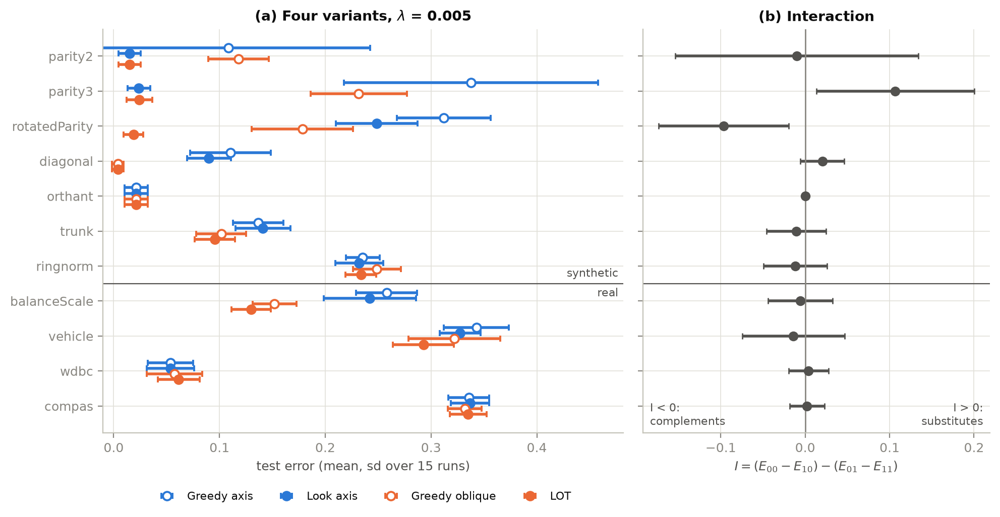
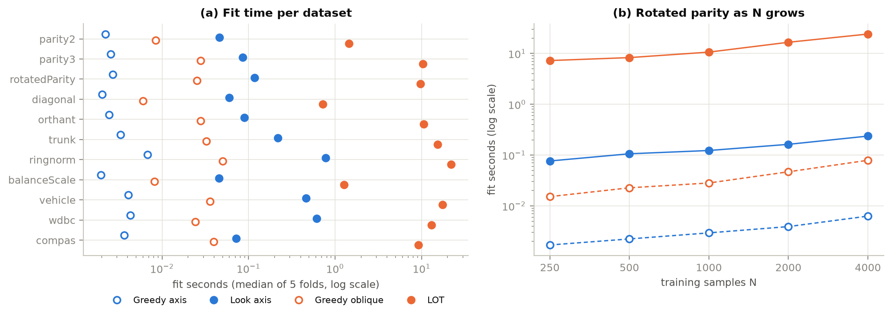
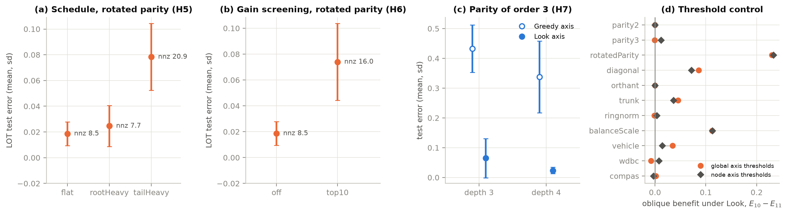

# LOT: Lookahead Oblique Trees

A decision tree with SPLIT's lookahead and SPORF's sparse oblique splits.
Two switches give four variants: greedy or lookahead, axis or oblique. Lookahead + oblique is LOT.

## Setup

```bash
python -m venv .venv
source .venv/bin/activate    # Windows: .venv\Scripts\activate
pip install -r requirements.txt
```

## Run

From inside `LOT/`:

```bash
python -m pytest tests.py            # tests
python fetch.py                      # download the real datasets (needs curl)
python experiment.py                 # main experiment -> results/runs.csv
python ablations.py                  # ablations -> results/ablations.csv
python timing.py                     # fit times on this machine -> results/timing.md, 20 min
python plots.py                      # tables and figures
python demo.py                       # LOT vs the other 3 on rotated parity, 2 s
```

## Folders

- `lot/` the tree, data, projections, metrics
- `tests.py` the important checks
- `results/` csv files and figures

## Results

All numbers are measured, from `results/`. Settings: depth 4, lambda = 0.005, gamma = lambda/2,
5-fold stratified CV repeated with 3 seeds (15 runs per cell, mean shown). This is SPORF's protocol
(5-fold CV, Cohen's kappa) repeated 3 times.

Datasets: the synthetic problems of SPORF plus `rotatedParity`, which we built to need both ideas, and
real datasets used in SPLIT or SPORF. Datasets over 2000 rows (Spambase, MAGIC, COMPAS) are subsampled to 2000.

### Accuracy, kappa and error

Test accuracy (%):

| Dataset | From | Greedy axis | Look axis | Greedy oblique | LOT |
|---|---|---|---|---|---|
| parity3 | SPORF | 66.2 | **97.6** | 76.8 | **97.6** |
| rotatedParity | ours | 68.8 | 75.1 | 82.2 | **98.1** |
| orthant | SPORF | **97.9** | **97.9** | **97.9** | **97.9** |
| trunk | SPORF | 86.3 | 85.9 | 89.8 | **90.4** |
| ringnorm | SPORF | 76.5 | **76.8** | 75.1 | 76.6 |
| *real data* | | | | | |
| balanceScale | SPORF | 74.2 | 75.8 | 84.8 | **87.0** |
| vehicle | SPORF | 65.7 | 67.3 | 67.8 | **70.7** |
| wdbc | SPORF | **94.6** | **94.6** | 94.3 | 93.9 |
| wine | SPORF | 92.9 | 93.1 | 92.5 | **93.7** |
| spambase | SPLIT, SPORF | 88.5 | 90.0 | 89.3 | **90.3** |
| magic | SPORF | 79.8 | 80.0 | 79.8 | **82.0** |
| compas | SPLIT | 66.4 | 66.3 | **66.8** | 66.5 |

Cohen's kappa (0 = chance, 1 = perfect):

| Dataset | From | Greedy axis | Look axis | Greedy oblique | LOT |
|---|---|---|---|---|---|
| parity3 | SPORF | 0.320 | **0.953** | 0.535 | 0.951 |
| rotatedParity | ours | 0.371 | 0.499 | 0.640 | **0.963** |
| orthant | SPORF | **0.976** | **0.976** | **0.976** | **0.976** |
| trunk | SPORF | 0.726 | 0.717 | 0.795 | **0.807** |
| ringnorm | SPORF | 0.527 | **0.534** | 0.502 | 0.531 |
| *real data* | | | | | |
| balanceScale | SPORF | 0.521 | 0.551 | 0.719 | **0.760** |
| vehicle | SPORF | 0.543 | 0.564 | 0.571 | **0.610** |
| wdbc | SPORF | **0.884** | **0.884** | 0.877 | 0.867 |
| wine | SPORF | 0.892 | 0.896 | 0.886 | **0.904** |
| spambase | SPLIT, SPORF | 0.757 | 0.788 | 0.775 | **0.796** |
| magic | SPORF | 0.524 | 0.551 | 0.544 | **0.595** |
| compas | SPLIT | 0.319 | 0.319 | **0.331** | 0.324 |

Test error:

| Dataset | From | Greedy axis | Look axis | Greedy oblique | LOT |
|---|---|---|---|---|---|
| parity3 | SPORF | 0.338 | **0.024** | 0.232 | **0.024** |
| rotatedParity | ours | 0.312 | 0.249 | 0.178 | **0.019** |
| orthant | SPORF | **0.021** | **0.021** | **0.021** | **0.021** |
| trunk | SPORF | 0.137 | 0.141 | 0.102 | **0.096** |
| ringnorm | SPORF | 0.235 | **0.232** | 0.249 | 0.234 |
| *real data* | | | | | |
| balanceScale | SPORF | 0.258 | 0.242 | 0.152 | **0.130** |
| vehicle | SPORF | 0.343 | 0.327 | 0.322 | **0.293** |
| wdbc | SPORF | **0.054** | **0.054** | 0.057 | 0.061 |
| wine | SPORF | 0.071 | 0.069 | 0.075 | **0.063** |
| spambase | SPLIT, SPORF | 0.115 | 0.100 | 0.107 | **0.097** |
| magic | SPORF | 0.202 | 0.200 | 0.202 | **0.180** |
| compas | SPLIT | 0.336 | 0.337 | **0.332** | 0.335 |

- Only LOT solves rotatedParity: 98.1% against at most 82.2%.
- LOT is best or tied on 9 of 12 datasets. On MAGIC it gains 2 points; on Wine and Spambase the gain is smaller than the spread across runs.
- No gain on ringnorm, WDBC and COMPAS.
- Lookahead never did worse than greedy on the training objective: 1800 out of 1800 runs.



Blue is axis splits, orange is oblique. Hollow is greedy, filled is lookahead.
Panel (b) is the interaction I: below 0 means the two ideas help each other.

### Fit time

Measured with `python timing.py` on a MacBook Air (M1, 4 performance + 4 efficiency cores,
8 GB RAM, macOS 15.7, Python 3.14, NumPy 2.5), on battery, one fit at a time.
Full tables are in `results/timing.md`. This run used the earlier dataset list (with parity2 and diagonal, before Wine,
Spambase and MAGIC were added), so the three new datasets are not in it.

| | Greedy axis | Look axis | Greedy oblique | LOT |
|---|---|---|---|---|
| fit time per tree | 2 to 7 ms | 0.05 to 0.8 s | 6 to 50 ms | 0.7 to 22 s |

- LOT is the slowest variant, 12 to 128 times slower than Look axis.
  Look calls greedy twice for every candidate split, and oblique splits add a few hundred candidates per node.
- Time grows slowly with N (about N^0.45 on rotated parity), because most of the work is per node, not per sample.
  On vehicle, sampling projections takes 49% of a LOT fit, building oblique columns 28%, and the gain maths only 7%.



### Ablations



LOT on rotated parity unless noted, test error:

- (a) Features allowed per split, by level: 3 everywhere 1.9%, fewer near the leaves 2.5%, fewer near the root 7.8%.
- (b) Looking ahead only at the top 10 candidates by gain: 7.4% instead of 1.9%. The right first split has zero gain, so it gets cut.
- (c) Parity of order 3 with Look axis: 6.5% at depth 3, 2.4% at depth 4.
- (d) Axis thresholds built per node, like the oblique ones: vehicle's oblique gain drops from 3.5 to 1.5 points,
  so part of the gain came from the per-node thresholds, not from the oblique direction.

## References

1. SPLIT: *Near-Optimal Decision Trees in a SPLIT Second*, ICML 2025.
2. SPORF: Tomita et al., *Sparse Projection Oblique Randomer Forests*, JMLR 2020.
